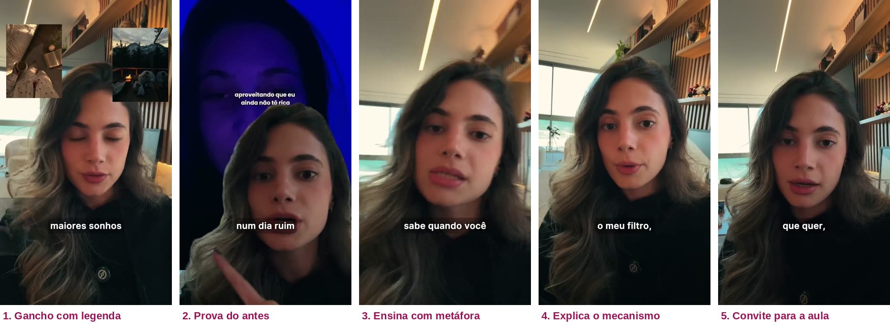

# 08 · Como vai funcionar (explicado de um jeito simples)
**Para a Camila ler antes de gravar · Comunidade AME-SE · nov/2026**

## A ideia em uma frase
Em vez de anunciar o curso, a gente vai anunciar **uma aula gratuita**. A aula entrega valor de verdade e, no meio dela, a Camila apresenta a Comunidade AME-SE como o caminho para continuar.

---

## Como funciona, passo a passo

1. **A pessoa vê um anúncio** no Instagram. É a Camila falando por 1 a 2 minutos, já ensinando alguma coisa útil, e convidando para uma aula gratuita.
2. **A pessoa comenta uma palavra** (PADRÃO) no anúncio.
3. **Chega uma mensagem no direct**: "toca em Eu quero". Ela toca, e aí chega o link da aula.
4. **Ela abre a página** e só vê o vídeo e o título. Mais nada.
5. **Ela assiste a aula.** É uma aula de verdade: ela aprende sobre o Padrão de Casa, as 3 formas como ele se repete e os 4 passos, e faz um exercício.
6. **Lá pelos 70% do vídeo**, a Camila começa a falar da Comunidade AME-SE. **Nesse momento, a página "abre" sozinha**: aparecem embaixo do vídeo o botão de compra, os módulos, os bônus, a garantia, o preço e as perguntas frequentes.
7. **Quem compra** vai para o checkout da Hotmart.
8. **Quem sai sem comprar** volta a ver a Camila em outro anúncio-aula (remarketing), com outro ensinamento, chamando de volta para a aula.

---

## Exemplo: um anúncio desse tipo

*Referência de mercado: anúncio-aula de outra criadora de conteúdo (Kamily Rebelatto, Método Prisma), que usa exatamente esse modelo. É só para mostrar o formato. **No nosso caso, no lugar dela vai estar o vídeo da Camila**, com o conteúdo e o jeito dela.*

O que reparar nesse exemplo (de 2min30):
- **Primeiros segundos:** ela fala olhando pra câmera, com legenda grande na tela e imagens pequenas aparecendo nos cantos.
- **Ela já ensina no anúncio:** explica uma ideia (o "filtro" na cabeça) com uma comparação do dia a dia (o feed do Instagram que vira só um assunto).
- **Ela não vende o curso no anúncio.** Ela vende **a aula gratuita**. O curso só aparece dentro da aula.
- **Cenário simples:** casa, luz natural, câmera do celular. Nada de estúdio.
- **No final:** um convite direto para assistir a aula.

---

## Por que a gente está fazendo assim

É uma forma de venda muito usada hoje no mercado para produtos acima de R$97. E faz sentido para a Camila por vários motivos:

- **Chama mais atenção.** "Aula gratuita" interessa muito mais do que "compre meu curso". Mais gente para, assiste e comenta.
- **Fica mais barato.** Quando o anúncio interessa mais, o clique, o contato (lead) e a venda tendem a sair mais baratos. Isso importa muito com a verba curta que a gente tem.
- **Funciona com quem não conhece a Camila.** Uma pessoa que nunca ouviu falar dela não compra um curso de cara. Mas assiste uma aula. E ao final da aula já conhece, já confia e já viu que ela sabe o que fala.
- **Funciona com quem já conhece.** Quem já segue a Camila ganha um conteúdo forte e um motivo novo para entrar na comunidade.
- **Gera autoridade e proximidade.** Em 20 minutos de aula, a pessoa vê a Camila ensinando de verdade: psicóloga, mestre, doutoranda, terapia do esquema e TCC. Isso faz o trabalho que um depoimento faria.
- **A pessoa chega ao preço já animada.** Quando a oferta aparece, ela acabou de aprender algo útil, fez um exercício e se reconheceu. É o melhor momento para decidir.
- **Dá para chamar de volta quem não comprou.** Todo mundo que entra na página fica marcado para o remarketing. Quem chegou até a parte da oferta é o público mais quente que existe.

---

## Preço: dois públicos, um vídeo só

- **Grupo VIP (WhatsApp):** R$ 97.
- **Quem chega pelos anúncios:** R$ 157, em até 12x.
- A Camila **não fala o número do preço na gravação**. Ela fala "o valor que está aparecendo aí na sua tela", e **o valor entra na edição**. Assim o mesmo vídeo serve para R$ 97, R$ 157 ou um valor futuro (por exemplo R$ 197), sem precisar regravar.
- O mesmo vale para o **bônus das 10 primeiras** (acompanhamento individual em formato de mentoria): entra como uma etiqueta na edição e um aviso logo abaixo do vídeo, na página, e sai quando as 10 vagas forem preenchidas.

## Escassez (só a verdadeira)
- **A aula sai do ar quando a campanha pausar.** A página e o link da automação são desligados junto.
- **Valor de lançamento das primeiras turmas.** Conforme entram novas turmas, com mais encontros em grupo, o valor tende a subir (por exemplo, para R$ 197).
- **As 10 primeiras** ganham o acompanhamento individual em formato de mentoria. Acabou, sai da página e do vídeo.

---

## O que a Camila precisa gravar

**1. Anúncios-aula (uma sessão de ~20 minutos)**
- **4 começos diferentes (ganchos)**, de 20 a 30 segundos cada: amor, família, amigas e trabalho.
- **1 corpo igual para todos**, de ~1 minuto.
- Na edição a gente junta: começo + corpo = 4 anúncios. Assim testamos qual tema traz mais gente gastando uma gravação só.
- O vídeo que ela gravou **na viagem** também vai subir como anúncio.

**2. A aula (VSL), de ~20 minutos**
- Pode ser gravada em 3 partes: abertura e história, a aula em si, e a oferta.
- Roteiro completo no arquivo `09-roteiro-vsl-v3.md`.

**3. Remarketing (opcional nesta primeira rodada)**
- Um anúncio-aula de ~90 segundos com outro ensinamento, para quem saiu sem comprar.

**Dicas de gravação:** celular na vertical para os anúncios e na horizontal para a aula, luz de janela de frente, roupa e cenário iguais em todas as partes, e falar como se estivesse conversando com uma paciente, não dando palestra.

---

## Cuidados (porque a Camila é psicóloga)

Pelo Código de Ética do psicólogo e pela regra da agência, a gente **não usa** algumas frases comuns nesse tipo de vídeo, e troca por versões verdadeiras:

| Em vez de… | A gente fala… |
|---|---|
| "Poderia custar mais de R$ 2.000" | "Já custou R$ 297" (é real) e "menos de um real por dia" |
| "7 dias grátis" | "7 dias de garantia" (a pessoa paga e pode pedir o dinheiro de volta) |
| Data inventada para a aula sair do ar | "A aula pode sair do ar a qualquer momento" **fica**, porque é verdade: quando a campanha pausar, a página da aula sai do ar |
| "O preço pode aumentar a qualquer momento" | "Esse é o valor de lançamento das primeiras turmas; com novas turmas e mais encontros, a tendência é subir" (o aumento precisa acontecer de fato) |
| "Você vai mudar em 7 dias" / "vai curar" | "Não é de um dia pro outro, mas o padrão pode deixar de dirigir sozinho" |
| Sorteio | "As 10 primeiras" (sorteio precisa de autorização do governo) |
| Sessão de terapia de brinde | Encontro individual **de mentoria do curso**, não de terapia |

E em tudo: **"a Comunidade AME-SE não substitui terapia"**.
