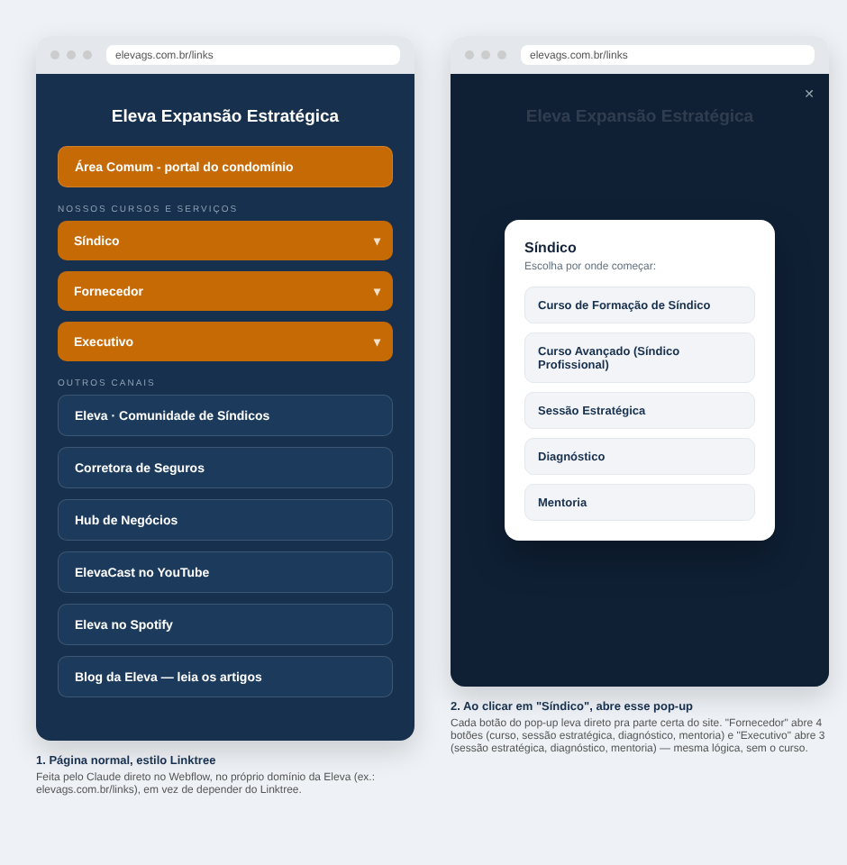

# Retorno da Recria — Área Comum, portal do condomínio
**RECRIA Marketing, 21/10/2026**
**Cliente:** Eleva

Retorno sobre os pontos abordados na última reunião e no material que você passou.

---

## 1. Peças (carrosséis e estáticos)

Gostamos bastante das peças, carrosséis e estáticos — ficou muito bom o conteúdo. E fez muito sentido esse reposicionamento, para conseguir vender não só para o síndico, mas também para os gestores e administradoras. Vamos seguir com esse material.

## 2. Estratégia de Google Ads

Concordamos com a estratégia de 4 grupos de anúncio em uma única campanha: um grupo de síndico profissional, outro de administradoras/gestores, outro de obrigações, e outro de marca.

## 3. Estratégia de Meta Ads

Revisamos os pontos levantados no documento e fazem sentido. Sobre o objetivo da campanha, especificamente:

### Tráfego ou Cadastro?

O objetivo ideal seria Cadastro, otimizando direto pela conversão — mas hoje isso esbarra em dois problemas, não só no Pixel: mesmo instalando o Pixel, o algoritmo da Meta precisa de cerca de 50 eventos de conversão por semana para sair da fase de aprendizado, e com R$25/dia de verba a gente dificilmente chega nesse volume — a campanha ficaria travada "aprendendo" sem nunca otimizar de verdade. Por isso a recomendação é **começar com objetivo Tráfego**, e assim que o Pixel estiver ativo e o volume de cadastros crescer (principalmente depois que a verba for escalando, ver "Ritmo de investimento" abaixo), reavaliamos a troca para Cadastro.

### Instalar o Pixel da Meta no Webflow

Sem o Pixel instalado na página, não conseguimos rastrear nenhum dos eventos relacionados às campanhas de Instagram/Meta — é o equivalente, na Meta, à tag do Google que já está configurada. Precisamos capturar **todos os eventos relevantes**: o cadastro (início do teste grátis) e também o evento de compra, já que às vezes a pessoa assina na hora do cadastro.

Pedimos para o seu Claude, que já está conectado ao Webflow, instalar o Pixel em todas as páginas do site. Segue o passo a passo para colar diretamente no chat dele:

> **Passo a passo para o Claude do Giuliano (Webflow):**
>
> 1. No painel do Webflow, ir em **Site Settings → Integrations**.
> 2. Procurar o campo **Facebook Pixel ID** (ou "Meta Pixel ID").
> 3. Colar o ID: `634359929729484`
> 4. Publicar o site.
> 5. Confirmar que o Pixel está disparando em todas as páginas, inclusive a do Área Comum - portal do condomínio.
> 6. Criar os eventos de conversão personalizados: um no clique de "Começar teste grátis" (cadastro), e outro (se houver um botão/fluxo de assinatura imediata) para o evento de compra.
> 7. Respeitar o consentimento de cookies: o Pixel só dispara depois do "Aceitar todos", igual já é feito com a tag do Google.
> 8. Testar com a extensão Meta Pixel Helper (Chrome) ou pela aba "Testar Eventos" do Gerenciador de Eventos da Meta, para confirmar que os eventos aparecem como "Recebendo dados".

Se o Claude dele não conseguir fazer essa instalação, nos avise que fazemos daqui.

### Atribuir a venda ao cadastro de 30 dias atrás

Sim, dá para rastrear: alguém se cadastra hoje e assina só daqui a 30 dias, e ainda assim atribuir essa venda ao canal certo (Google ou Meta) — mas o caminho técnico é um pouco diferente em cada plataforma:

- **No Google**: é mais direto. O Google Ads aceita janela de conversão de até 90 dias, e dá para importar a "conversão offline" (a venda que aconteceu depois) usando o GCLID (o identificador que fica salvo no cadastro). Também conecta nativamente com o Google Analytics (GA4), que já faz esse tipo de atribuição de longo prazo.
- **Na Meta**: também é possível, mas com mais trabalho — a janela de atribuição padrão do próprio relatório da Meta é curta (7 dias de clique). Para os 30 dias, o caminho é guardar o identificador do clique (FBCLID) no momento do cadastro e, quando a venda acontecer, disparar o evento de compra via Conversions API (API de Conversões, do lado do servidor), vinculado àquele clique original — mas isso não aparece automaticamente no relatório padrão da Meta, é mais um dado pra análise nossa/do time técnico do que um número que a própria plataforma mostra pronto.

Isso é trabalho de desenvolvimento (guardar o GCLID e o FBCLID no cadastro, e disparar o evento de venda depois vinculado a eles) — vale perguntar pro Claude do Giuliano se o portal já guarda esses identificadores no cadastro, porque sem isso não tem como fazer essa atribuição depois.

### Confirmação da tag do Google

Não temos como verificar diretamente daqui se a tag do Google (GTM) está puxando certinho o evento de cadastro — isso só é possível com a extensão Tag Assistant no navegador, ou com o print "Gravando conversões" que o próprio documento do Giuliano já pede como condição para ativar as campanhas. Pedimos esse print antes de ligar tudo, incluindo o evento de compra, se houver.

### Ritmo de investimento

Entendemos que o teto máximo é R$ 3.700, conforme definido por você. Vamos começar com um investimento mínimo nos primeiros dias, para forçar as campanhas a entregarem o máximo de cadastro pelo menor custo possível, e ir aumentando a verba aos poucos, de acordo com o resultado de cadastros.

**Um adendo**: como as campanhas são de tráfego/cadastro, não de venda direta, o custo na Meta tende a ficar mais barato — o leilão da Meta cobra mais caro quanto mais "fundo de funil" é o objetivo (uma campanha de venda direta compete por um público mais qualificado e mais caro). No Google, essa lógica não se aplica do mesmo jeito: o custo por clique na Rede de Pesquisa é definido principalmente pela concorrência de cada palavra-chave no leilão, não pelo objetivo da campanha — então não esperamos essa mesma economia por ser uma campanha de cadastro em vez de venda.

## 4. Calendário dos carrosséis

Gostamos muito dos carrosséis, ficaram muito bons. Nossa sugestão: postar um carrossel por semana, intercalado com os outros conteúdos que já estão no feed, a partir da semana em que o Área Comum - portal do condomínio for ao ar — sem dinâmica de lançamento, como você pediu. Entram nessa fila o carrossel de Produto, a Série Recursos e a Série Relatórios.

## 5. Linktree

Em vez do Linktree, nossa sugestão é o seu Claude criar uma página própria, no mesmo estilo, direto no domínio da Eleva (por exemplo, elevags.com.br/links). A vantagem: dá para ter um pop-up quando a pessoa clicar em "Síndico", "Fornecedor" ou "Executivo", abrindo os botões certos para cada público — recurso que o Linktree gratuito não tem.

**Como ficaria:**
- Botão **Síndico** → abre pop-up com: Curso de Formação de Síndico, Curso Avançado (Síndico Profissional), Sessão Estratégica, Diagnóstico, Mentoria.
- Botão **Fornecedor** → abre pop-up com: Curso para Fornecedor, Sessão Estratégica, Diagnóstico, Mentoria.
- Botão **Executivo** → abre pop-up com: Sessão Estratégica, Diagnóstico, Mentoria.
- Os demais itens (Área Comum, Comunidade de Síndicos, Corretora de Seguros, Hub de Negócios, YouTube, Spotify, Blog) ficam como botão único, levando direto para a página certa.

Segue um esboço de como ficaria:

## 6. Plataforma que vamos usar para disparos em massa no WhatsApp

Comparamos os dois fornecedores possíveis para o disparo via API oficial da Meta aos ~450 síndicos da sua agenda:

| | **Nextags** | **SocialHub** |
|---|---|---|
| Mensalidade (faixa até 2.500 contatos — cobre os 450 de sobra) | **R$ 147,00/mês** | A partir de R$ 299,00/mês (plano exato a confirmar) |
| Tarifa de disparo da Meta (~1.200 msgs/mês, 3 envios) | Cobrada à parte, direto no Gerenciador de Anúncios (~R$ 384/mês) | Não informada no site — ver observação abaixo |
| **Total estimado/mês** | **~R$ 531,00** | **~R$ 483 a R$ 683,00**, dependendo da tarifa |
| Recursos inclusos | Caixa de entrada multicanal, automações, agentes de IA, campanhas e segmentação, CRM, API/webhooks | CRM, chatbot com IA, campanhas, e-mail marketing |
| Fidelidade | Mensal, cancela quando quiser | Sem fidelidade |

**Observação sobre a tarifa da Meta**: o site do SocialHub não deixa claro se esse valor já inclui a tarifa de disparo da Meta ou não. Pela experiência do mercado, o mais comum é vir separado — você paga a plataforma de disparo de um lado, e a tarifa da Meta é cobrada à parte, direto no Gerenciador de Anúncios, dentro do gerenciador de WhatsApp da conta. Se você conseguir esse valor direto com eles, nos ajuda bastante, porque não achamos essa informação no site.

**Recomendação: Nextags.** Além do custo final estimado ser menor, a Amanda já conhece bem a ferramenta — inclusive já prestou consultoria para um e-commerce que faturou R$ 500 mil usando disparo de WhatsApp para uma base de 200 mil pessoas (venda de suplementos). É uma ferramenta que já mostrou resultado forte na prática.

## 7. Próximos passos

Já estamos na etapa de configurar as campanhas de Google e Meta, deixando tudo programado e pausado, pronto para ir ao ar quando você confirmar a data certa em novembro. Da sua parte, fica só a instalação do Pixel pelo seu Claude (ou nos avise se precisar que a gente faça daqui).
