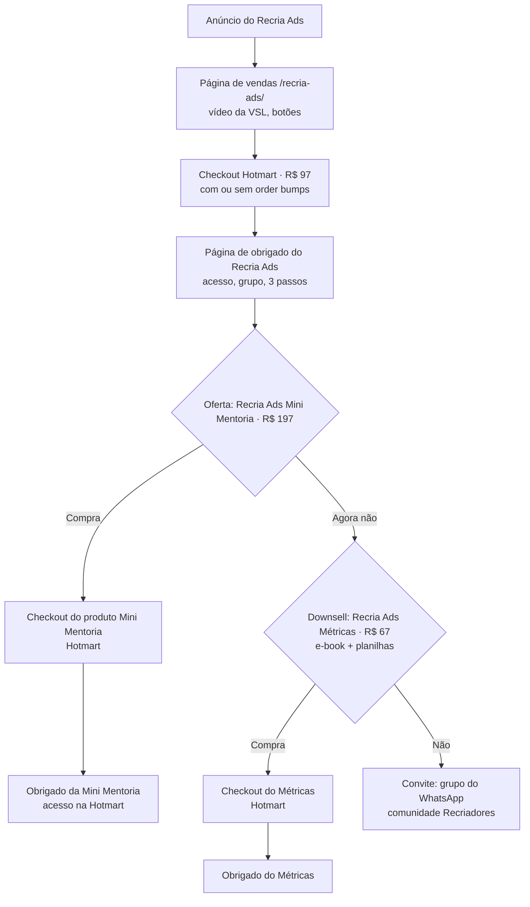

# Fluxo do Recria Ads, do anúncio ao grupo do WhatsApp

## Diagrama

## Prazos da Mini Mentoria
- **Até o dia 7:** primeira aula (vídeo, na plataforma) e link para agendar.
- **Até o dia 15:** planilhas e material de apoio.
- **1º encontro:** entre o dia **30 e o dia 60** da compra (de 1 a 2 meses, para ela aplicar de verdade).
- **2º encontro:** de **1 a 2 meses depois do 1º** (interpretação a confirmar: contados a partir do 1º encontro).
- **Total:** até cerca de 4 meses. Até 3 tentativas de agendar cada encontro; depois, só pelo WhatsApp.
- Sem usar os encontros nos prazos: só vídeo e documento gerais.
- Encontros gravados no Google Meet pago e transcritos (ata) para a Amanda montar a tarefa e o documento final.

## Status por etapa
| Etapa | O que é | Status | Quem |
|---|---|---|---|
| Anúncio | Criativos e campanha do Recria Ads | **Falta** (a VSL está pronta e na página; faltam os criativos de anúncio) | Claude + Amanda |
| Página de vendas | `/recria-ads/` com VSL, botões, "Na prática" | **Pronta** | — |
| Checkout 97 | Recria Ads + **order bumps** | **Definir** quais order bumps entram | Amanda decide, Claude sugere |
| Obrigado do Recria Ads | Acesso, grupo, 3 passos | **Pronta** | — |
| Oferta Mini Mentoria | Texto, régua, prazos, avisos | **Pronta**, só aparece com o link | Amanda: link da Hotmart |
| Produto Mini Mentoria (Hotmart) | R$ 197, produto separado | **Falta criar** | Amanda |
| Obrigado da Mini Mentoria | Página do produto novo | **Falta** (depois do produto existir) | Claude |
| Primeira aula (vídeo) | Boas-vindas, na plataforma | **Falta gravar** (roteiro pronto) | Amanda grava, Claude edita |
| Planilhas / material de apoio | Para a autoanálise | **Falta** (esqueleto pronto) | Amanda + Claude |
| Agendamento com regras | Janela 30–60 dias, 3 tentativas, validação da compra | **Falta** (webhook da Hotmart + script) | Claude |
| Tarefa pós-1º encontro | Ata → tarefa personalizada | **Processo definido** | Amanda traz a ata, Claude monta |
| Documento final | Entrega do 2º encontro | **Falta modelo** | Amanda + Claude |
| Vídeo e documento gerais | Para quem perder os prazos | **Falta** | Amanda + Claude |
| Downsell Métricas | E-book + planilhas, R$ 67 | **Texto pronto na página**, produto **falta** | Amanda + Claude |
| Convite ao grupo | Comunidade Recriadores | **Pronto** | — |
